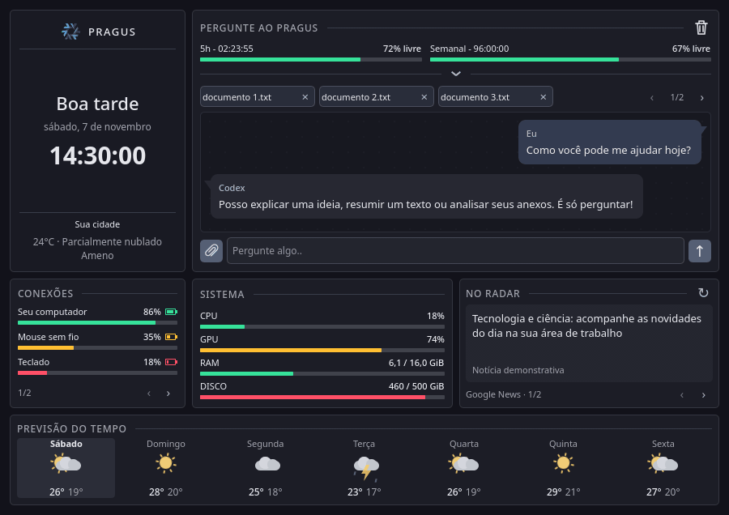

<div align="center">


# PRAGUS

**Seu assistente, seu sistema e seu dia. Na área de trabalho.**

Um widget para KDE Plasma 6 com chat via Codex, monitoramento do computador, notícias e previsão do tempo — em um painel compacto, cinza e com animações discretas.




<sub>Visão geral do painel com dados demonstrativos.</sub>

</div>

## O que ele faz

- **Pergunte ao PRAGUS:** respostas em tempo real identificadas como Pragus, carregamento com logo pulsando e pontos animados, interrupção e limpeza da conversa. Seleção de modelo e de esforço; os níveis de esforço aparecem por extenso, em caixa alta e sem cortes. Barras mostram o saldo disponível das cotas de 5 horas e semanal, com contagem regressiva para renovação em horas, minutos e segundos.
- **Histórico com contexto:** o botão de relógio abre conversas disponíveis no Codex local dentro do cartão **Pergunte ao Pragus**, incluindo Desktop, CLI e outros clientes que compartilham o mesmo armazenamento. Busque por título, prévia, origem ou pasta, carregue mais resultados e retome uma conversa com seu histórico. O painel fecha ao clicar fora ou mudar para outra janela. A última conversa é recuperada ao reabrir o widget.
- **Anexos:** imagens e arquivos no contexto da pergunta, com miniaturas compactas, remoção individual e paginação por setas em uma faixa de uma linha, com a mesma transição suave das notícias. A lixeira limpa também os anexos ainda não enviados.
- **Sistema:** CPU e GPU em porcentagem; RAM e disco em GiB usados/total. As barras ficam verdes abaixo de 70% de uso, amarelas de 70% a menos de 90% e vermelhas a partir de 90%. Os textos e valores permanecem brancos.
- **Conexões:** bateria do computador e dos periféricos que publicam essa informação no Linux. Baterias e saldo das cotas ficam verdes acima de 40%, amarelos acima de 20% até 40% e vermelhos até 20%; em Conexões, o ícone de bateria acompanha a cor da barra. O nome do computador vem do modelo DMI, com alternativa para o hostname. Quando há mais de três conexões, setas permitem alternar as páginas com animação, mantendo o tamanho do cartão.
- **No radar:** manchetes do Google News Brasil, uma por vez, com troca a cada 30 segundos e pausa ao passar o mouse. Atualizar volta à primeira notícia. O nome da fonte aparece apenas no rodapé da manchete.
- **Previsão do tempo:** localização aproximada pela rede, condição atual e sete dias de previsão, com máximas e mínimas. Ícones de sol, nuvens, chuva, neve e trovoada têm animações contínuas no próprio widget. Os dados são atualizados automaticamente a cada dez minutos; as animações permanecem em movimento entre as consultas.

O layout adapta os cartões à largura disponível. Relógio e saudação seguem o fuso configurado no sistema; a previsão usa o fuso da localização detectada.

## Conversas no Pragus

Use a seta abaixo das cotas para escolher o modelo e o esforço de raciocínio. Os níveis disponíveis acompanham o modelo selecionado e aparecem por extenso, como **BAIXO**, **MÉDIO**, **ALTO** e **EXTRA ALTO**.

O ícone de relógio no cartão **Pergunte ao Pragus** abre o histórico somente na área desse cartão. A busca filtra as conversas já carregadas por título, prévia, origem ou pasta; a barra de rolagem permite navegar pela lista, e **Carregar mais conversas** busca outros resultados quando disponíveis. Em layouts estreitos, o painel rola até deixar o cartão do chat visível.

Selecione uma conversa para recuperar suas mensagens e continuar com o contexto anterior. O histórico fecha após recuperar a conversa, clicar fora, mudar para outra janela, pressionar **Esc** ou usar **×**. Clicar fora mantém a ação do item escolhido. Para começar outra conversa, use **+** no histórico ou a lixeira do chat; as conversas salvas continuam disponíveis na lista.

A última conversa é recuperada automaticamente ao reabrir o widget. O histórico depende das conversas disponíveis no armazenamento local do Codex; conversas exclusivas do navegador/nuvem não aparecem automaticamente.

## Tecnologias

| Camada | Tecnologias |
| --- | --- |
| Interface | QML, Qt Quick, Qt Quick Controls, Layouts e Shapes |
| Integração com o desktop | KDE Plasma 6 e KPackage |
| Núcleo | C++17, Qt Core, GUI, QML, Network e D-Bus |
| Assistente | Codex CLI App Server por JSON-RPC via entrada/saída padrão |
| Métricas e dispositivos | `/proc`, `/sys`, UPower e BlueZ; `nvidia-smi` quando disponível |
| Clima e localização | Open-Meteo; ipwho.is, ipinfo.io e ipapi.co como alternativas |
| Notícias | RSS do Google News Brasil |
| Compilação | qmake, GNU Make, Bash e Python 3 para empacotar |

## Instalação

Requer Linux com **KDE Plasma 6**, compilador C++, Qt 6 com os módulos usados acima, qmake, Make, Python 3 e `kpackagetool6`. O projeto foi desenvolvido no CachyOS; outros sistemas com Plasma 6 precisam fornecer as dependências equivalentes.

No CachyOS / Arch Linux:

```bash
sudo pacman -S --needed gcc make python qt6-base qt6-declarative kpackage
```

Para conversar, instale o [Codex CLI](https://github.com/openai/codex) e autentique sua própria conta:

```bash
codex login
```

Na pasta do projeto:

```bash
./install.sh
```

O instalador compila o plugin nativo e instala ou atualiza o widget do usuário. Depois, procure **PRAGUS** em **Adicionar widgets** no Plasma. A disponibilidade dos modelos e das cotas depende da conta autenticada.

Após atualizar uma instalação existente, recarregue o Plasma para carregar o novo plugin:

```bash
systemctl --user restart plasma-plasmashell.service
```

Para apenas gerar o pacote, execute `./build.sh`. O resultado é `codex-desk.plasmoid`; esse arquivo e o plugin compilado ficam fora do Git. O identificador `local.codex.desk` é mantido para preservar as configurações de instalações anteriores.

Para desinstalar:

```bash
kpackagetool6 -t Plasma/Applet -r local.codex.desk
```

## Dados e privacidade

O repositório contém código, recursos visuais e uma prévia demonstrativa. Credenciais, arquivos de ambiente, logs e binários gerados são ignorados pelo Git. O widget usa o login do Codex CLI, sem chaves de API embutidas no código.

As conversas são mantidas pelo Codex local, conforme a conta e as configurações do CLI. O Pragus salva o estado de recuperação, incluindo o identificador da conversa atual, em `~/.local/share/codex-desk/chat-state.json` (ou no caminho definido por `XDG_DATA_HOME`) para recuperar mensagens e contexto ao reiniciar. Esse arquivo é privado do usuário. **Perguntas, contexto recuperado e anexos enviados são processados pelo Codex.** Limpar o widget inicia outra conversa e remove o estado local de recuperação; não apaga conversas já registradas pelo CLI ou pelo serviço.

O histórico lista as conversas locais acessíveis ao app-server usado pelo widget, sem restringir à pasta do Pragus. Desktop e CLI precisam compartilhar o mesmo armazenamento do Codex (`CODEX_HOME`, quando configurado). Conversas que existem apenas no navegador/nuvem não são sincronizadas automaticamente por essa integração. A interface não oferece importação de conversas por arquivo.

A retomada usa os métodos oficiais [`thread/list`, `thread/resume` e `thread/turns/list`](https://developers.openai.com/codex/app-server/), preservando o contexto da conversa e sua pasta de trabalho. A lista de mensagens exibida inclui perguntas, respostas e referências a anexos; registros internos de ferramentas não aparecem como balões de chat.

Os anexos são copiados para uma pasta temporária privada, preservando os originais. As cópias são removidas ao limpar a conversa ou ao encerrar normalmente o widget; uma interrupção abrupta do processo pode deixá-las no diretório temporário. Limites: dez arquivos por pergunta, 25 MB por arquivo e 100 MB no total. Imagens têm envio próprio; outros formatos dependem das ferramentas de leitura disponíveis. As conversas solicitam ambiente de leitura e o cliente recusa pedidos de aprovação de alterações e comandos privilegiados.

Clima e notícias fazem consultas HTTPS a serviços externos. Os provedores de localização recebem o IP público da conexão; o Open-Meteo recebe as coordenadas aproximadas. A cidade e o clima ficam no cache local do usuário, em `~/.cache/pragus/weather.json` (ou no caminho definido por `XDG_CACHE_HOME`), fora da pasta do projeto. A localização pode divergir com VPNs e redes de operadoras.

## Atualizações e limites

| Informação | Intervalo |
| --- | --- |
| Relógio | 1 segundo |
| CPU, GPU, RAM e disco | 2 segundos |
| Baterias | 5 segundos, conforme os dados publicados pelo dispositivo |
| Cotas do Codex | 15 segundos e eventos do servidor |
| Localização e clima | 10 minutos, com cache e novas tentativas em caso de falha |
| Notícias | 5 minutos; também podem ser atualizadas pelo botão |

Bateria não informada aparece como `—`. Alguns receptores de teclado, incluindo variantes do AULA F75, não expõem porcentagem pelo UPower/BlueZ; o widget não estima valores. Celulares com cabo apenas de carga podem não ser identificados. A leitura de GPU depende do driver; dados indisponíveis também aparecem como `—`.

O projeto usa português do Brasil e notícias brasileiras por padrão. Não há servidor próprio nem configuração de chave para clima ou notícias. A disponibilidade e os limites desses serviços podem mudar.

Para verificar recuperação, paginação e persistência do chat, execute `bash tests/run.sh`. Os testes compilam o plugin e usam um app-server simulado local; não enviam perguntas à conta do usuário.

## Estrutura

```text
native/                 Núcleo C++, leitura de histórico e configuração do qmake
package/
  metadata.json         Metadados do widget
  contents/ui/          Interface QML, painel de histórico e recursos visuais
  contents/ui/bridge/   Registro do módulo nativo
docs/preview.gif        Prévia demonstrativa
tests/                  Testes locais de histórico e protocolo, sem inferência real
build.sh                Compilação e empacotamento
install.sh              Instalação ou atualização local
```

## Licença

[MIT](LICENSE). PRAGUS é um projeto independente, sem afiliação com OpenAI, KDE ou os provedores de dados.
